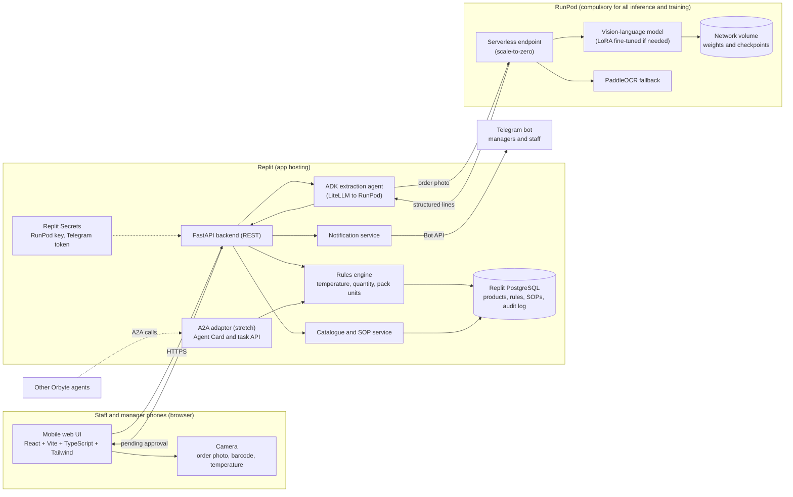

# 1st Proposal: Smart Receiving Check for F&B SMEs

**Challenge:** Orbyte Smart SME Challenge, Domain 2
**Deadline:** Sunday 25 Oct 2026, 08:00 MYT (submit by 06:00 as buffer)
**Status:** Proposal, for team approval (revised: ADK, Telegram notifications, planned fine-tune, strict $25 budget)

---

## 1. Problem

Small F&B outlets lose stock and money at the point of delivery:

- Frozen goods arrive outside their safe temperature range and are accepted anyway.
- Bundle and box quantities are counted wrongly (e.g. 250 pcs per bundle, 12 packets per box), so stock and orders drift apart.
- Staff are not trained on the correct receiving steps, and nobody records what happened.

These are recurring, daily losses, and they are invisible until stock runs out or food spoils.

## 2. Solution

One automated journey: **Receiving check**. Staff record each delivery in a phone-friendly web app. The system reads the delivery order, checks each line against product rules, sends any failures to a manager for approval, notifies the people involved on Telegram, and logs the outcome.

AI reads and explains. Rules decide. Humans approve.

## 3. The journey

| Step | What happens | Who |
|---|---|---|
| **Trigger** | Staff tap "Receive delivery" | Staff |
| **Data** | Photo of delivery order is taken; scan or pick each product; enter probe temperature per line | Staff |
| **Extraction** | An ADK extraction agent calls the model on RunPod, which reads the order and returns line items (item, quantity, pack unit) as JSON. Staff confirm each line. | AI (ADK + RunPod) |
| **Logic** | Rules engine checks temperature range, quantity vs. expected, and pack-to-base-unit conversion | Code (no AI) |
| **Approval** | Any failed check goes to a manager: accept, reject, or return, with a reason | Manager |
| **Notification** | Telegram message to the manager when approval is needed; Telegram message to staff with the decision | Telegram bot |
| **Logged outcome** | Audit record saved (who, when, readings, photo, decision); stock on hand updated | System |

Stretch goals, only if the core is done: (1) low-stock alert on Telegram that drafts a reorder for manager approval; (2) an A2A endpoint that exposes the receiving check to other Orbyte agents (ADK supports A2A); (3) approve or reject with inline buttons in Telegram.

## 4. Scope

**In (v1):**
- Product catalogue with categories (create, edit, delete)
- Per-product rules: temperature range, base unit, pack conversion, minimum threshold
- Receiving journey end to end, happy path and fail path
- Manager approval and audit log
- Telegram bot notifications for managers and staff
- ADK extraction agent (and a simple SOP lookup agent if time allows)
- One planned LoRA fine-tune of the extraction model on RunPod, if zero-shot results fall short of the thresholds or the challenge rules require training
- SOP cards per product, plus a simple SOP lookup for staff
- Seed data: 10 products including the examples from the brief (frozen sausage, chocolate balls, fries tray, hot dog box, nuggets, Coke)

**Out (roadmap):**
- Demand forecasting
- POS integration
- Multi-outlet support
- Real IoT thermometers
- Full SOP editor with version history
- Custom-trained object detection (YOLO)
- Training a model from scratch
- Multi-agent orchestration beyond extraction and SOP lookup

## 5. Tech stack

| Layer | Choice | Why |
|---|---|---|
| **Compute / AI inference and training** | **RunPod (compulsory)** | All model inference and any fine-tuning run here. Serverless endpoint (scale-to-zero) for the live app; a Pod for short experiments only. |
| **Model** | Open-weight vision-language model, served on RunPod, about 3B to 7B parameters. Shortlist: Qwen VL-family and Gemma multimodal variants (confirm vision support). Kimi and DeepSeek flagships are too large for a 24 GB GPU and the budget. Final pick made on Wed 21 Oct after testing 2 candidates zero-shot on the test set in section 12. | Reads delivery-order photos into JSON. |
| **Fine-tuning** | LoRA / QLoRA on a 24 GB RunPod GPU, one planned run (about 2 to 3 hours). Trained on synthetic and public data; evaluated on the held-out hand-labelled set. | Meets a "train on RunPod" requirement and improves extraction if zero-shot falls short. |
| **Fallback OCR** | PaddleOCR, on the same RunPod endpoint | Used if the model misreads numbers on the order |
| **Other AI** | Allowed if it runs on RunPod. No external inference API is used in the core path. | Keeps the compliance story clean |
| **Agent framework** | Google ADK, running in the Python backend. The model is the RunPod-served model, reached through ADK's LiteLLM wrapper against the endpoint's OpenAI-compatible API (vLLM), so there is no Gemini default and no inference outside RunPod. ADK is used narrowly: an extraction agent, and an optional SOP lookup agent. The rules engine and approval flow stay plain code. | Satisfies the stack choice while keeping pass or fail deterministic. |
| **Agent interop (stretch)** | A2A endpoint (Agent Card and task endpoint) that wraps the receiving check, using ADK's A2A support. Added on Saturday only if the core works. | Lets other Orbyte agents reuse the receiving check |
| **Notifications** | Telegram bot (Bot API, called from the FastAPI backend, webhook mode). Staff link their account by sending the bot a one-time code, which stores their `chat_id`. | Instant alerts to managers and staff without building a notification system. |
| **App hosting** | Replit (deployment) | Hosts the web app and API. Replit does no training. |
| **Backend and REST API** | Python, FastAPI. FastAPI is the REST layer; there is no separate middleware tier. | Same language as the ADK agent and the RunPod worker, so one codebase for logic and model calls |
| **Frontend** | React + Vite + TypeScript + Tailwind CSS, mobile-first. Vite builds static files that FastAPI serves. | TypeScript types the API responses, which catches frontend and backend mismatches early. Tailwind speeds up phone-friendly UI. React has the most examples for forms and camera UIs. |
| **Database** | Replit PostgreSQL (fall back to SQLite if the plan lacks it) | Stores catalogue, rules, SOPs, Telegram links, and audit log |
| **Barcode scan** | html5-qrcode in the browser | Uses the phone camera; no ML needed |
| **Secrets** | Replit Secrets | Holds the RunPod endpoint key and the Telegram bot token; never committed to git |
| **Model weights** | RunPod network volume | Avoids re-downloading the model on every cold start. Storage may be billed separately. |
| **Development mock** | A fake extraction response used for all non-AI development | Only the real extraction path touches the GPU, which saves budget |
| **Tests** | pytest for the rules engine and extraction parser, using sample delivery orders | Proves the logic, not just the UI |
| **Source control** | GitHub repo `SDCIdea26` | Team history and submission |

**Not used:** YOLO or any other custom-trained detector in v1. Training would need a labelled dataset we do not have, and the journey does not require detection. Training from scratch is also not used; only a light fine-tune of an existing open-weight model.

### 5.1 Architecture diagram

**Reading the diagram:** staff use the browser on their phones. The Replit backend holds all business logic and data. The only AI step runs on RunPod: the ADK extraction agent sends the order photo to the RunPod endpoint and gets back structured lines. The rules engine, not the model, decides pass or fail. Manager approval happens in the same web UI, and the Telegram bot notifies managers and staff at each step. The A2A adapter is a stretch item that lets other Orbyte agents call the same rules engine.

## 6. Rules (deterministic, no AI)

- **Temperature:** reading must fall inside the product's range. Example: frozen sausage −20 °C to −10 °C; chocolate balls −10 °C to 0 °C. Outside the range = fail.
- **Quantity:** received quantity is converted to base units (e.g. 2 bundles × 250 pcs = 500 pcs) and compared with the expected quantity. Any difference = fail.
- **Missing data:** a missing temperature or unrecognised product = fail, so a human must check it.
- **Approval:** any fail blocks the delivery from being marked accepted until a manager decides.

## 7. Timeline (MYT)

The deadline is Sunday 08:00 MYT, so Saturday night is the last work session. Submit by 06:00 Sunday.

| Day | Date | Goal | Done when |
|---|---|---|---|
| Tue | 20 Oct | Lock scope and owners. Confirm hackathon rules on other AI models and fine-tuning. Confirm the Coke pack unit and Orbyte modules. Start labelling 10 to 20 mock orders. | Scope signed off; owners assigned; mock orders started |
| Wed | 21 Oct | Model day. Create one serverless endpoint (24 GB pool, scale-to-zero). Test PaddleOCR-VL first, then one Qwen3-VL 7B-class model, on the mock orders (section 12). Start Replit and the catalogue. | Model chosen from the scores; spend under about $3 |
| Thu | 22 Oct | Connect Replit to the endpoint. ADK go/no-go by midday: if the LiteLLM path fails, call the endpoint directly. Fine-tune decision by evening: only if both models fail the thresholds and the rules require training. | Photo in, lines out, from the app; fine-tune decision recorded |
| Fri | 23 Oct | Receiving journey end to end: happy path, fail path, rules engine, manager approval, audit log. Test on a real phone. | A delivery can be recorded, checked, approved, and logged |
| Sat | 24 Oct | SOP cards and lookup. Demo data. Telegram, time-boxed to 3 hours; if not working by 16:00, switch to in-app notifications. | Full journey runs on the demo phone |
| Sun | 25 Oct | Early hours: rehearse the demo, bug fixes only. Submission pack: slides, 2-minute video, README, endpoint link. | Submitted by 06:00 |

**Freeze:** after Sat 22:00 no new features. Only bug fixes and submission material.

**Cut order if behind:** Telegram, then SOP lookup, then ADK. Keep the receiving journey and the rules.

**Checkpoints:** Wed 21 evening (model chosen, or fall back to manual entry); Thu 22 midday (ADK go/no-go); Sat 24 16:00 (Telegram go/no-go).

## 8. Business benefit

Pick one metric and measure it in the demo, using stated assumptions only:

- Minutes per delivery saved (manual counting vs. photo + confirm)
- Number of out-of-range deliveries caught before acceptance
- Estimated spoiled stock avoided per month (state the assumption explicitly)

Do not quote statistics we cannot source.

## 9. SDG link

- **SDG 12.3 (primary):** reduce food waste and losses along supply chains. Catching bad deliveries at receiving stops spoiled stock entering the kitchen.
- **SDG 8 (secondary):** SOP cards and the lookup help new staff learn correct handling quickly.

## 10. Orbyte fit

The Orbyte platform details are not yet confirmed. Before Wed 21 Oct, the team should check which Orbyte modules and APIs are available (for example login, inventory, approvals). Reuse them rather than rebuilding, and name them in the pitch. Until then, the design keeps those parts behind a thin interface so they can be swapped in.

## 11. Risks and mitigations

| Risk | Mitigation |
|---|---|
| Scope creep | Scope fixed in section 4; feature freeze Sat 22:00 |
| Model misreads the delivery order | Staff confirm every extracted line before it is saved; OCR fallback; fine-tune if needed |
| ADK does not work cleanly with the RunPod-served model | Test the LiteLLM-to-vLLM path on Wed. If it fails, call the RunPod endpoint directly from the extraction function and keep ADK for the SOP lookup or the A2A stretch. |
| RunPod cold start makes the demo slow | Keep the endpoint warm for the demo; pre-run one request before judging |
| RunPod cost overrun ($25 hard cap) | Budget in section 13; strict cost rules; develop against a mock; stop endpoints after each test run |
| Telegram webhook or linking problems on Replit | Test on Wed; fall back to in-app notifications only, and keep Telegram as a bonus |
| Orbyte modules unclear | Check on Wed; fall back to standalone auth and catalogue |
| Rules change between teammates | Rules live in the database as data, with unit tests as the source of truth |

## 12. Data plan

We do not train from scratch. Data is used to test the candidates, to run one light fine-tune if needed, and to show judges how the model was chosen.

| Data | Source | Used for | Notes |
|---|---|---|---|
| Receipt and invoice images | Kaggle: [OCR Receipts Text Detection](https://www.kaggle.com/datasets/trainingdatapro/ocr-receipts-text-detection), [CORD_1000](https://www.kaggle.com/datasets/lonelvino/cord-1000), [Expenses Receipt OCR](https://www.kaggle.com/datasets/sushmithanarayan/expenses-receipt-ocr) | Warm-up, extraction tests, optional fine-tune data | Check each license. The retail set asks you to contact the publisher before commercial use. |
| Mock delivery orders | Team-made, 10 to 20 orders | **Test set only** for both candidates and for before/after fine-tune comparison | Label the true lines by hand. Include blur, skew, and handwriting. Mark as test data. Never use for training. |
| Synthetic delivery orders | Generated by script from templates with our real products, pack units, fonts, blur, and skew; the generating data is the label | Fine-tune training set (hundreds of examples) | Built off-GPU on Wed. Mark as synthetic. |
| Product rules and pack conversions | Team, from the store | Seed data and rules | Settle the Coke conversion first. |
| Shelf images | Kaggle: [Supermarket Shelves Dataset](https://www.kaggle.com/datasets/humansintheloop/supermarket-shelves-dataset) | Only if product counting is added | Not in v1. |

**Test protocol (proposed thresholds):**
- Valid JSON on at least 95% of test orders
- Item, quantity, and unit exactly right on at least 90% of lines
- Latency and cost per order recorded for each candidate

**Decision rule:**
1. Run both candidates zero-shot. If one meets the thresholds, it is the pick (lower cost per order wins a tie).
2. If neither meets them, or the challenge rules require training, run the single planned LoRA/QLoRA fine-tune on the synthetic and public data, then re-score on the held-out test set. Present the before and after numbers.
3. Fix hyperparameters from a short sanity run (about 20 examples) before the real run. Retry only if the run clearly fails.
4. If the thresholds are still missed, the app still works: staff type or correct the lines, and the rules and approval flow run as normal.

## 13. Budget (USD 25, hard cap)

Assumption: a 24 GB GPU costs about $0.69 per hour. That is a 2024 published rate, so confirm it on RunPod's live pricing page first. The plan targets less than half of the cap, with the rest held as reserve.

| Item | GPU hours | Cost | When |
|---|---|---|---|
| Zero-shot test, 2 candidates | 3 | $2.07 | Wed 21 Oct |
| Fine-tune (one QLoRA run, plus a short sanity run) | 3 | $2.07 | Thu 22 Oct, only if needed |
| Evaluation after fine-tune | 1 | $0.69 | Thu 22 Oct |
| Development and debugging endpoint | 5 | $3.45 | Thu to Fri |
| Demo warm-up and rehearsal | 2 | $1.38 | Sat to Sun |
| **Planned total (GPU)** | **14** | **$9.66** | |
| **Unspent reserve** | | **about $15.34** | Do not touch unless a step fails |

Network volume storage is not included above and may be billed continuously. Check it on Wed and count it.

**Cost rules:**
- Confirm live GPU pricing and volume billing before starting anything.
- Use the cheapest GPU that fits (24 GB class is enough for a 3B to 7B model with QLoRA). No A100 or H100.
- Start with 3B to 7B models.
- Prepare everything off the GPU: write and test the training script and dataset on CPU or a tiny sample before starting a Pod. Do not debug code while the meter runs.
- Pods only for experiments. Stop each one as soon as the job finishes. Never leave a Pod running overnight.
- Use serverless with scale-to-zero, one worker at most, and a short idle timeout (about 5 to 10 seconds). Delete unused endpoints.
- Develop everything except the real extraction path against a mock response.
- Write checkpoints to the volume so an interrupted run is not repeated.
- Set a spend alert or auto-pause in RunPod if the account allows it.
- Check the balance after every session and log it in a shared note.
- Fine-tune once, planned. Skip it if zero-shot already meets the thresholds and the rules do not require training.

## 14. Open items for the team

1. Confirm the hackathon rules on other AI models and on whether training or fine-tuning on RunPod is required (proposal assumes any open-weight model is allowed if it runs on RunPod).
2. Confirm the Orbyte modules and APIs available to us.
3. Confirm the pack conversion for Coke. The brief says "8 oz (4.5 kg) / box", which mixes units, so the team must agree on the base unit before seeding data.
4. Fill in the owners in section 15.
5. Confirm the RunPod price and volume billing on the live pricing page, and approve the budget split in section 13.
6. Check the license of each Kaggle dataset before use.
7. Verify that ADK's LiteLLM path works against the RunPod-served model (Wed).
8. Create the Telegram bot token and agree on who gets which notifications (managers, staff, or both).

## 15. Owners

Fill in names once the team confirms. Five members, one role each.

| Role | Owner | Owns |
|---|---|---|
| Leader | | Scope, timeline, go/no-go calls, RunPod budget, demo video, submission pack |
| Backend | | FastAPI, rules engine, catalogue, database, approval and audit API |
| Frontend | | React screens, photo and barcode capture, approval screen, phone testing |
| AI and RunPod | | Endpoint setup, model tests, JSON output, ADK check, fine-tune if needed |
| Data, Telegram and QA | | Seed products, mock orders, Telegram bot and linking, test cases and bug log |
